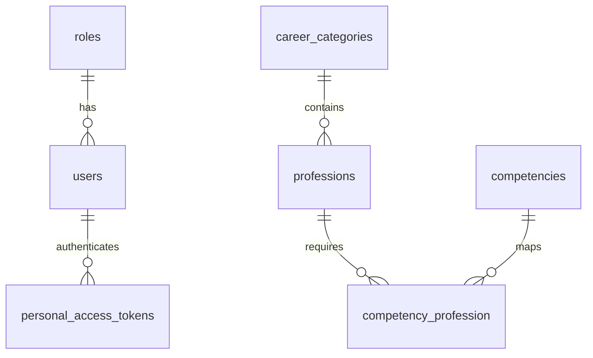

# Career Compass Backend

REST API JSON untuk mahasiswa S1 Sistem Informasi Telkom University Kampus Jakarta. Implementasi ini mencakup autentikasi, profil, pengelolaan role, US-11 (admin mengelola profesi), dan US-12 (mahasiswa menjelajahi profesi).

Laravel 13, PHP 8.3+, MySQL 8, Sanctum 4, Eloquent, migrations, middleware, policies, API resources, dan Form Request. Versi dependensi dikunci dalam `composer.lock`. Aplikasi ini backend saja; Node.js tidak diperlukan. Career Assessment dan penilaian assessor belum diimplementasikan.

## Menjalankan secara lokal

1. Aktifkan MySQL, misalnya melalui Laragon. Buat database kosong melalui terminal MySQL atau database manager:

   ```sql
   CREATE DATABASE career_compass CHARACTER SET utf8mb4 COLLATE utf8mb4_unicode_ci;
   ```

2. Dari direktori proyek, instal dependensi dan siapkan konfigurasi. Perintah berikut memakai PowerShell:

   ```powershell
   composer install
   Copy-Item .env.example .env
   php artisan key:generate
   ```

   Jika `.env` sudah tersedia, gunakan file tersebut. Sesuaikan `DB_HOST`, `DB_PORT`, `DB_DATABASE`, `DB_USERNAME`, dan `DB_PASSWORD` dengan MySQL lokal. Ekstensi PHP yang diperlukan antara lain `pdo_mysql`, `mbstring`, `openssl`, `dom`, `xml`, `ctype`, `fileinfo`, dan `curl`.

3. Jalankan migrations dan seeders, lalu server:

   ```powershell
   php artisan migrate --seed
   php artisan serve
   ```

   API tersedia di `http://127.0.0.1:8000/api`. `GET /` mengembalikan identitas API; `GET /up` adalah health endpoint Laravel.

## Akun demo dan master data

Akun demo hanya dibuat ketika `APP_ENV=local` atau `testing`.

| Role | Email | Password awal |
| --- | --- | --- |
| Admin | admin@careercompass.test | CareerCompass123! |
| Assessor | assessor@careercompass.test | CareerCompass123! |
| Mahasiswa | mahasiswa@careercompass.test | CareerCompass123! |

Set `DEMO_USER_PASSWORD` di `.env` **sebelum** menjalankan seeder untuk memakai password lain. Seeder berulang mempertahankan akun yang sudah ada dan tidak mereset password. Environment produksi melewati seeder akun demo; pemanggilan langsung `DemoUserSeeder` di produksi ditolak. Untuk produksi, buat admin awal melalui proses operasional dengan akses server terpercaya, kemudian gunakan endpoint admin untuk perubahan role.

Seeder menyediakan tiga role, empat kategori karier, 16 kompetensi, dan lima profesi lengkap: Software Engineer, Data Analyst, Business Analyst, UI/UX Designer, dan System Analyst. Master kategori serta kompetensi tersedia untuk dibaca admin; tidak ada CRUD master pada tahap ini.

## Endpoint

Kirim `Accept: application/json`, `Content-Type: application/json` untuk body JSON, dan `Authorization: Bearer <token>` pada endpoint private.

| Method | Path | Akses / perilaku |
| --- | --- | --- |
| POST | `/api/auth/register` | Publik; selalu membuat mahasiswa |
| POST | `/api/auth/login` | Publik; mengembalikan token Sanctum dan user |
| POST | `/api/auth/logout` | Semua role; mencabut token yang digunakan |
| GET | `/api/auth/me` | Semua role; profil sendiri |
| PUT | `/api/auth/profile` | Semua role; memperbarui profil sendiri |
| GET | `/api/professions` | Mahasiswa; katalog aktif, pagination dan pencarian |
| GET | `/api/professions/{id}` | Mahasiswa; detail profesi aktif |
| GET | `/api/admin/professions` | Admin; semua profesi termasuk nonaktif |
| POST | `/api/admin/professions` | Admin; menambahkan profesi |
| GET | `/api/admin/professions/{id}` | Admin; detail termasuk profesi nonaktif |
| PUT / PATCH | `/api/admin/professions/{id}` | Admin; mengubah seluruh / sebagian field |
| DELETE | `/api/admin/professions/{id}` | Admin; menonaktifkan profesi |
| GET | `/api/admin/career-categories` | Admin; master kategori |
| GET | `/api/admin/competencies` | Admin; master kompetensi |
| GET | `/api/admin/roles` | Admin; daftar role |
| GET | `/api/admin/users` | Admin; daftar user dengan pagination |
| PUT | `/api/admin/users/{id}/role` | Admin; mengubah role pengguna lain |
| GET | `/api/assessor/me` | Assessor; demonstrasi otorisasi area assessor |

Admin memakai endpoint `/api/admin/professions` untuk membaca katalog. Endpoint `/api/professions` dikhususkan bagi mahasiswa. Assessor memiliki autentikasi, profil, dan area identitas sendiri tanpa endpoint penilaian.

### Registrasi dan login

Body registrasi:

```json
{
  "name": "Mahasiswa Baru",
  "email": "mahasiswa.baru@example.com",
  "password": "SecurePassword123!",
  "password_confirmation": "SecurePassword123!",
  "nim": "1202230099",
  "phone": "08123456789"
}
```

`name`, `email`, `password`, dan konfirmasi password wajib; `nim` serta `phone` opsional. Email dinormalisasi menjadi huruf kecil dan wajib unik. NIM opsional juga unik. Password minimal delapan karakter, mengandung huruf dan angka, maksimal 72 byte sesuai batas bcrypt, serta tidak mengandung karakter null. Field `role` dan `role_id` dilarang pada registrasi dan pembaruan profil.

Body login hanya memerlukan `email` dan `password`. Response login (200) / registrasi (201):

```json
{
  "message": "Login berhasil.",
  "data": {
    "token": "1|token-sanctum",
    "token_type": "Bearer",
    "user": {
      "id": 1,
      "name": "Admin Career Compass",
      "email": "admin@careercompass.test",
      "role": "admin",
      "nim": null,
      "phone": null,
      "bio": null,
      "created_at": "2026-10-22T00:00:00.000000Z",
      "updated_at": "2026-10-22T00:00:00.000000Z"
    }
  }
}
```

Password hash dan remember token disembunyikan pada model serta tidak disertakan dalam API resources. Login dibatasi lima request per menit untuk kombinasi email/IP dan 30 request per menit per IP. Registrasi dibatasi lima request per menit per IP.

### Profil dan role

`PUT /api/auth/profile` menerima sebagian field `name`, `email`, `nim`, `phone`, `bio` (maksimal 2.000 karakter). Password opsional harus disertai `password_confirmation` dan `current_password` yang benar. Perubahan password mencabut token perangkat lain; token request saat ini tetap berlaku. Perubahan email menghapus status verifikasi email lama. Tidak ada fitur verifikasi email pada tahap ini.

`PUT /api/admin/users/{id}/role` menerima:

```json
{ "role": "assessor" }
```

Nilai yang diizinkan: `admin`, `assessor`, `mahasiswa`. Admin tidak dapat mengubah role dirinya sendiri. Perubahan role dilakukan dalam transaksi dengan row lock, mempertahankan minimal satu admin, dan mencabut seluruh token pengguna yang rolenya berubah. Pengguna tersebut harus login ulang. Penggantian role tidak membuat kewenangan penilaian bagi admin.

### Menambah dan mengubah profesi

Ambil ID kategori dan kompetensi dari endpoint master sebelum menyimpan. Contoh body:

```json
{
  "name": "Quality Assurance Engineer",
  "description": "Memastikan kualitas aplikasi melalui pengujian yang terencana.",
  "responsibilities": [
    "Menyusun test plan dan test case.",
    "Menjalankan pengujian regresi dan mendokumentasikan temuan."
  ],
  "career_category_id": 1,
  "competency_ids": [1, 4],
  "is_active": true
}
```

Semua field selain `is_active` wajib pada POST dan PUT. `is_active` default `true`. PATCH menerima sebagian field; field yang dikirim tetap harus valid. `responsibilities` wajib berupa array berurutan dengan 1–50 string; `competency_ids` array berurutan berisi 1–100 ID yang ada dan tidak duplikat. Satu profesi memiliki satu kategori, nama unik, dan minimal satu kompetensi. Penyimpanan profesi beserta sinkronisasi kompetensi berlangsung dalam satu transaksi.

Response detail memuat `id`, `name`, `description`, `responsibilities`, `is_active`, objek `career_category`, array `competencies`, serta timestamps. Setiap kategori/kompetensi memuat `id`, `name`, dan `description`.

DELETE melakukan **penonaktifan**, sehingga baris profesi dan pivot kompetensinya tetap tersimpan. Mahasiswa tidak melihat profesi nonaktif pada katalog dan mendapatkan 404 pada detailnya. Admin tetap dapat membukanya dan mengaktifkannya kembali dengan `PATCH {"is_active": true}`. Foreign key memakai `RESTRICT` untuk melindungi master yang direferensikan; fitur yang kelak menghubungkan profesi dengan mahasiswa perlu mengikuti prinsip yang sama.

### Pencarian dan pagination

```http
GET /api/professions?keyword=analyst&per_page=2&page=1
```

Pencarian nama profesi memakai Eloquent `whereLike` dengan parameter binding. Pencarian bersifat tidak peka huruf besar/kecil pada konfigurasi MySQL yang disediakan. `%` dan `_` mengikuti perilaku wildcard SQL LIKE. `keyword` maksimal 150 karakter, `per_page` default 15 (rentang 1–100), dan `page` minimal 1. Parameter yang sama tersedia pada daftar profesi admin. Daftar user admin memakai `page` dan `per_page`.

Response pagination memakai format Laravel `data`, `links`, dan `meta` (termasuk `total`, `current_page`, `per_page`, `last_page`). Hasil pencarian kosong tetap 200 dengan `data: []`, `meta.total: 0`, dan pesan `Tidak ada profesi yang ditemukan.` Tidak ada syarat menyelesaikan Career Assessment.

### Status HTTP

| Status | Arti |
| --- | --- |
| 200 | Berhasil, termasuk hasil kosong dan penonaktifan |
| 201 | Akun atau profesi berhasil dibuat |
| 401 | Kredensial salah atau token tidak valid / telah dicabut |
| 403 | Role tidak berwenang atau kebijakan melarang operasi |
| 404 | Data tidak ditemukan atau profesi nonaktif diakses mahasiswa |
| 422 | Validasi gagal; response berisi `message` dan `errors` per field |
| 429 | Batas request autentikasi terlampaui |

Semua error `/api/*` berbentuk JSON, termasuk request yang tidak menyertakan header Accept.

## Struktur data



- `users.role_id` menghubungkan user dengan satu role.
- `professions.career_category_id` menghubungkan profesi dengan satu kategori.
- `competency_profession` memiliki primary key gabungan untuk mencegah pasangan duplikat.
- `personal_access_tokens` mengikuti mekanisme Sanctum; hanya hash token disimpan di database.
- Tabel cache, jobs, sessions, dan password reset berasal dari fondasi Laravel; tidak menambahkan fitur assessment.

Implementasi dipusatkan pada `app/Http/Requests`, `app/Http/Controllers`, `app/Http/Resources`, `app/Http/Middleware`, `app/Policies`, `app/Models`, `database/migrations`, `database/seeders`, dan `routes/api.php`.

## Pengujian

Pengujian cepat memakai SQLite in-memory yang terisolasi (memerlukan `pdo_sqlite`):

```powershell
php artisan test
vendor/bin/pint --test
composer validate --strict
```

Untuk menguji pada MySQL, buat **database khusus pengujian yang kosong**, lalu jalankan dari PowerShell baru:

```sql
CREATE DATABASE career_compass_test CHARACTER SET utf8mb4 COLLATE utf8mb4_unicode_ci;
```

```powershell
$env:DB_CONNECTION = 'mysql'
$env:DB_HOST = '127.0.0.1'
$env:DB_PORT = '3306'
$env:DB_DATABASE = 'career_compass_test'
$env:DB_USERNAME = 'root'
$env:DB_PASSWORD = ''
php artisan test
```

Tests memakai `RefreshDatabase`, sehingga koneksi pengujian harus menunjuk ke database khusus. Jangan gunakan database aplikasi. Variabel `$env:` hanya berlaku untuk sesi PowerShell tersebut; tutup sesi setelah pengujian agar perintah aplikasi kembali mengikuti `.env`.

Suite memeriksa registrasi, validasi, login seluruh role, token asli Sanctum, logout, profil, pembatasan role melalui middleware dan policies, CRUD/penonaktifan profesi, relasi database, pencarian, pagination, perubahan role serta pencabutan token, dan seeder berulang. Contoh request yang dapat dijalankan melalui ekstensi VS Code REST Client tersedia di [docs/api.http](docs/api.http).

## Referensi implementasi

Fondasi mengikuti dokumentasi resmi [Laravel 13](https://laravel.com/docs/13.x), [Sanctum](https://laravel.com/docs/13.x/sanctum), [authorization](https://laravel.com/docs/13.x/authorization), dan [validation](https://laravel.com/docs/13.x/validation). Saat deployment, gunakan document root `public`, set `APP_ENV=production` dan `APP_DEBUG=false`, serta konfigurasi kredensial server sendiri.
